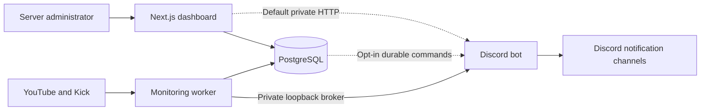

# NAVI Live Notifier

YouTube and Kick livestream alerts for Discord, managed through a server-specific web dashboard. NAVI combines a Next.js website, a Discord bot and an independent monitoring worker with persistent PostgreSQL delivery records.

**The source code is public under the MIT License; the maintainer-hosted NAVI bot is not publicly available.** The hosted service remains in controlled private-beta preparation. No approved public dashboard address or NAVI invite link is published here. Cloud deployment and hosted-bot production activation remain **NO-GO**. Independent MIT self-hosting source publication is a separate decision. See the [installation status and prerequisites](docs/INSTALLATION.md).

## Independent self-hosting and source distribution

This repository is publicly available under the MIT License, independently of the hosted NAVI service. Each self-hoster supplies their own Discord application, bot/OAuth credentials, provider keys, allowlists, PostgreSQL data and hosting. There is no required NAVI operator account or maintainer-hosted backend. Approval language for test sends/monitoring means approval by the owner of that instance; this review does not enable those effects.

The source-release changes have been merged into `main`, and the repository is public. See [Phase 19 source-release readiness](docs/PHASE_19_PUBLIC_RELEASE_READINESS.md) for the pre-publication verification record. Publishing the source does not make a centrally hosted NAVI bot available.

## Features and supported platforms

- Discord OAuth login/logout and management access checked on the server for each guild.
- YouTube handle/channel URL and Kick username/channel URL resolution using official APIs, with confirmation before saving.
- Per-server streamer subscriptions; add, enable, disable and remove registrations.
- Per-streamer Discord destinations, editable message templates and a single optional mention selection: none, an eligible role or explicitly selected @everyone.
- Sample previews and labelled test notifications. Tests can ping a selected role; they never ping @everyone.
- YouTube red livestream embeds and Kick green embeds with available title, artwork, category and stream links.
- Independent LIVE confirmation, reconciliation, persistent duplicate prevention, bounded retries and explicit uncertain delivery handling.
- An opt-in PostgreSQL dashboard-command transport for separate hosting, with acknowledgments and permission rechecks. HTTP remains the default; the consumer remains disabled.

These features exist in source and automated tests. They are **not a claim that a hosted public service, fresh real livestream tests or continuous cloud operation has been verified**. Registration alone does not activate monitoring. No scheduled reminders, new OFFLINE alerts or public slash-command interface are offered.

## Architecture



PostgreSQL stores sessions, identities, guild subscriptions, preferences, delivery evidence and commands. Redis is a validated legacy configuration/local-tooling service; NAVI's durable queue is PostgreSQL, not Redis. The private broker must never be exposed publicly. See [architecture](docs/03-architecture.md) and the [cloud deployment plan](docs/PHASE_15F_CLOUD_DEPLOYMENT_PLAN.md).

## Installation status and adding NAVI

**Discord server owners:** there is nothing publicly installable yet. Do not use an unofficial invite. Once the operator publishes an approved entry point, sign in, select a server you manage, use **Install NAVI**, authorize Discord and refresh installation status. The current Add to Discord button leads to login; it is not a public universal invite.

Approved testing also requires the operator's user/guild allowlists and Discord's private-application restrictions. Follow the [installation guide](docs/INSTALLATION.md) for the implemented sequence and the outstanding release gates. A bot-installed badge is not proof that the monitoring worker is running.

## Configure notifications

1. Open your authorized server's **Streaming Channels** page.
2. Select YouTube or Kick, review the policy notice, resolve the account and confirm its identity.
3. Open **Notifications** and choose a destination for that streamer.
4. Edit the template using `{streamer}`, `{platform}`, `{title}` and `{url}`.
5. Choose **No mention**, an eligible role or @everyone. Everyone mentions require explicit selection and the bot's effective Mention Everyone permission.
6. Save settings and use **Preview message** first. Send a real labelled test only with approval for that channel.

Both the subscription and automatic-notification setting must be enabled, with a separately approved running worker, for automatic alerts. YouTube and Kick can use different destinations. See [configuration](docs/CONFIGURATION.md).

## Dashboard overview

| Page               | Current behavior                                                                        |
| ------------------ | --------------------------------------------------------------------------------------- |
| Your servers       | Lists authorized, in-scope Discord servers and installation status.                     |
| Overview           | Server identity, connection status and setup guidance.                                  |
| Streaming Channels | Resolve, confirm and manage YouTube/Kick subscriptions.                                 |
| Notifications      | Destinations, templates, mentions, previews, saved preferences and labelled tests.      |
| Settings           | Informational server workspace; general server-preference controls are not implemented. |

There are **no user-facing Discord slash or prefix commands**. Configuration is dashboard-based. Read the [commands reference](docs/COMMANDS.md).

## Developer quick start

Anyone can clone the public default branch and run the non-sending verification commands below without platform credentials:

```sh
git clone https://github.com/NAVI-SL/NAVI-Live-Notifier.git
cd NAVI-Live-Notifier
npm ci
npm run env:check:example
npm run check
npm run build
```

Use Node.js 24 and npm 11.15.0 for the documented environment; the exact supported engine range is in [package.json](package.json). PostgreSQL 17 and local Redis 7 are provided by [compose.yaml](compose.yaml). These verification commands do not start the applications or establish live provider connectivity.

For fresh database setup, your own Discord/YouTube/Kick credentials, safe environment files, migrations and separate service startup, follow [self-hosting](docs/SELF_HOSTING.md). Do not run all services just to inspect the dashboard: enabling the worker can change webhook subscriptions and send messages.

## Technology stack

TypeScript npm workspaces; Next.js 16/React 19; Better Auth; discord.js; PostgreSQL with Drizzle ORM and node-postgres; Vitest/PGlite; ESLint/Prettier; Docker Compose and reviewed Nginx deployment examples. Shared packages live under `packages/config`, `core`, `database` and `tsconfig`; applications are under `apps/web`, `bot` and `worker`.

## Documentation

- [Installation and release prerequisites](docs/INSTALLATION.md)
- [Notification configuration](docs/CONFIGURATION.md)
- [Commands and dashboard actions](docs/COMMANDS.md)
- [Developer self-hosting](docs/SELF_HOSTING.md)
- [Deployment guide](docs/DEPLOYMENT_GUIDE.md), [cloud plan](docs/PHASE_15F_CLOUD_DEPLOYMENT_PLAN.md) and [production checklist](docs/PRODUCTION_CHECKLIST.md)
- [Operations](docs/OPERATIONS_RUNBOOK.md), [rollback](docs/ROLLBACK_PLAN.md) and [data deletion process](docs/DATA_DELETION_PROCESS.md)
- [Phase 17 documentation verification](docs/PHASE_17_DOCUMENTATION_REPORT.md)

Earlier phase reports are dated evidence, sometimes describing superseded functionality or original development ports. Current source, the new user guides and the Phase 15F plan distinguish implemented behavior from blocked deployment validation. Older upload manifests are historical snapshots.

## Security, contributing and license

Never upload real environment files, credentials, database exports, private keys, logs or generated build output. Use scoped server authorization, minimal Discord permissions, explicit safe mentions and private internal services. See [security reporting](SECURITY.md) and [contribution guidance](CONTRIBUTING.md).

The owner selected the **MIT License**; see [LICENSE](LICENSE) for the complete standard terms. Copyright year: 2026. The copyright holder is NAVI-SL. License terms are complete; the owner accepted disclosure of existing Git commit email metadata before publication. Third-party packages, images and trademarks retain their own terms; see the [Phase 18 review](docs/PHASE_18_PUBLIC_RELEASE_READINESS.md).

## Source release verification

See [Phase 19 source-release readiness](docs/PHASE_19_PUBLIC_RELEASE_READINESS.md) for the pre-publication verification record and remaining hosted-service limitations. Earlier privacy-cleanup and encrypted-rehearsal plans are historical and canceled; they are not self-hosting prerequisites. Each instance owner supplies their own credentials and infrastructure. This source release does not enable a shared NAVI service, public Discord installation or automatic monitoring.

## Current project status

Phase 15 implementation was committed to a feature branch in Phase 16B and subsequently merged into `main`. Phase 16A independently recorded 537 automated tests, 27 disposable PostgreSQL scenarios, five Redis probes and production builds passing; full/production dependency audits reported zero findings at that time. These are dated local/simulated results, not public uptime or live-delivery receipts. The older four-moderate-advisory README statement is superseded by the reviewed lockfile and dated evidence.

Phase 17 prepared documentation, and Phase 19 published the MIT-licensed source. Public installation still needs approved hosting and HTTPS origins, verified callbacks, private-beta onboarding, fresh YouTube/Kick delivery evidence, operational alerts/restore/capacity validation, and reviewed policy/support/deletion details. No deployment, queue activation or public launch is authorized by this README.
