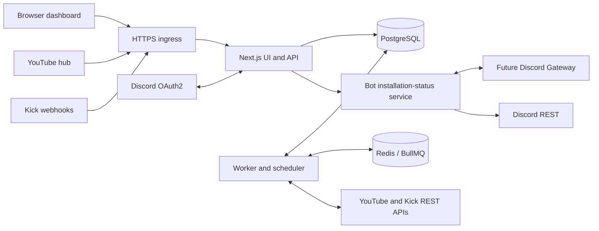

# Proposed system architecture

**Phase 13 — 2026-10-20:** [stabilization](PHASE_13_IMPLEMENTATION.md) preserves the web/bot/worker/SQL queue boundary. The actual bot entry point combines REST and existing Gateway lifecycle for private readiness. Worker health adds last completed tick, bounded process-local outcome/latency aggregates and cached persisted provider reservations; PostgreSQL remains authoritative for deduplication/recovery. Console transitions are not installed external alerting. No migration, extra provider request or public diagnostic endpoint; deployment acceptance remains open.

**Phase 12 — 2026-10-20:** optional `BETA_GUILD_IDS` (1–5 distinct IDs) is enforced by web authorization/selection/install and worker eligibility/fan-out/send payload checks. Current private account allowlist and fresh Discord management checks remain; actual scope not configured. Retained YouTube IDs now use up to two ≤50 batches, with four-call worst-case scheduling budget. Existing SQL queue, uniqueness, sender, LIVE/freshness checks and broker boundary unchanged; no migration. [Controlled-release plan](PHASE_12_RELEASE_PLAN.md) records preparation only/NO-GO and supersedes older cadence and unbounded-admission descriptions below.

**Kick rich-format update — 2026-10-18:** worker forwards optional metadata from its existing official active-stream read through the current JSONB session payload and bot broker. The same bot sender renders green Kick embeds and link buttons, requiring current Embed Links. Queue, deduplication and detection architecture are unchanged; no delivery-message ID/offline editing lifecycle was added. Dashboard preview is sample-only. See [current contract](KICK_NOTIFICATION_EMBEDS.md).

**YouTube local reconciliation update — 2026-10-18:** each due YouTube poll refreshes new candidate IDs through official channel/uploads APIs before video status checks. The budget calculation accounts for three one-unit calls per source/cycle with confirmation/retry headroom; one source at the default budget runs nominally every minute. The former 15-minute discovery gate no longer controls YouTube. Kick, persistent queue/deduplication, freshness/baseline policy and bot-owned sender are unchanged. See [current correction and verification limits](YOUTUBE_MONITORING_DEBUG.md).

**Phase 8 deployment preparation:** [the current deployment guide](DEPLOYMENT_GUIDE.md) proposes a single Linux Docker host with separate web/bot/worker processes, shared edge network namespace preserving loopback broker boundaries, PostgreSQL persistent storage and runtime-mounted service secrets. Redis is not used by the current PostgreSQL queue. No public infrastructure was created; container and live acceptance remain pending. This current contract supersedes older future deployment descriptions below.

**Current Phase 7:** the existing PostgreSQL queue and bot-owned sender now include hint-generation reconciliation, activation/attempt fencing, safe pre-send retries, adaptive YouTube polling, private health and bounded shutdown. [Phase 7 implementation](PHASE_07_IMPLEMENTATION.md) describes that runtime contract. The subsequent user-requested [Gateway presence update](DISCORD_GATEWAY_PRESENCE.md) adds one persistent discord.js client to the bot process with only Guilds intent; REST delivery and the private broker retain their existing responsibilities. Phase-specific paragraphs and the larger architecture proposal below retain historical scope; idle-worker/no-delivery statements do not describe the current runtime. Redis/BullMQ and history UI remain unimplemented proposals. Phase 8 is unauthorized.

**Current Phase 6 implementation:** the independent worker owns official API observation, authenticated webhook hints, schedules/budgets and PostgreSQL-backed session/delivery admission. It holds provider credentials and the private broker secret, never the Discord bot token. The existing bot sender now renders verified live notifications as well as sample tests, reusing channel/role verification and mention/nonce safety. Dedicated PostgreSQL coordination serializes automatic sends against settings/subscription changes. Redis/BullMQ and the broader inbox/outbox proposal below remain future design; this personal implementation uses the database queue directly. See [Phase 6 contract](PHASE_06_IMPLEMENTATION.md); later phase scope is not authorized.

Historical Phases 2–3: authentication/install and protected dashboard follow the user-authorized stack, with Better Auth explicitly selected by the user. See [current roadmap](DEVELOPMENT_ROADMAP.md), [authentication setup](PHASE_02_AUTHENTICATION.md) and [dashboard/recovery contract](PHASE_03_DASHBOARD.md). Dashboard leaf pages independently reauthorize every server request. The broader provider proposal below differs from the concrete Phase 6/7 implementation.

Phase 4 implements official public-account lookup and registration in the web process. Plain TypeScript provider adapters resolve identities; the registration service reauthorizes each operation, signs actor/guild-bound confirmations and uses a guild-scoped PostgreSQL repository. Global `provider_channels` and per-guild `streamer_subscriptions` separate identity from configuration. See [the Phase 4 contract](PHASE_04_STREAMER_REGISTRATION.md) for schema, errors, retention, setup and verification limits. Phase 5 extends the bot responsibilities as described below. No provider webhooks, monitoring jobs or automatic delivery are implemented.

## Stack and boundaries

Phase 5 current implementation: web-owned notification settings/preview/test admission reuse existing guild subscriptions and the bot-owned loopback REST integration. The bot now lists writable ordinary text channels and eligible roles, revalidates both before explicit labelled test sends, and owns all bot-token calls. Shared `@navi/core` contracts validate templates and suppress arbitrary mentions. PostgreSQL stores versioned settings and bounded test admission/outcomes, without a generic outbox or automatic sender. The worker remains idle. See [the Phase 5 contract](PHASE_05_NOTIFICATION_SETTINGS.md); this supersedes earlier status-only/no-message descriptions for the current runtime. Detection and automatic delivery below remain future design.

Use TypeScript across a modular monorepo: Next.js dashboard and HTTP API, a separate long-running Node.js worker, PostgreSQL for durable state, and Redis/BullMQ for delayed/background jobs. Use discord.js for the Gateway and Discord REST integration. Keep provider adapters and authorization/domain logic independent of framework handlers. Choose supported compatible versions and a migration/query library during implementation; no packages are installed now.

This gives one language, shared validation contracts, durable relational constraints, and a worker that survives browser closure. It adds PostgreSQL/Redis operational overhead. A database-only job queue is a reasonable simplification if approved before implementation; it must preserve the inbox/outbox and retry guarantees. Avoid independent microservices and Kubernetes for personal development.

Official capability references: [Next.js self-hosting](https://nextjs.org/docs/app/guides/self-hosting), [BullMQ](https://docs.bullmq.io/), [discord.js](https://discord.js.org/docs/packages/discord.js/main). These support the proposal; choosing this stack is an engineering judgment.

Future webhook routes will write a durable inbox; a worker/outbox dispatcher will publish queue jobs. Redis will carry identifiers rather than secrets or full provider payloads. This future processing is unimplemented. The bot process owns the bot token and exposes credential-protected loopback status, channel/role lookup and explicit test-send operations. The web process reauthorizes the user's guild before these operations and holds user OAuth credentials/sessions through Better Auth/PostgreSQL. The background worker remains idle and has no Discord credentials. There is no Gateway login or automatic sending. Future delivery coordination must be reviewed separately.

## Local execution and eventual deployment

Proposed local topology: dashboard/API on loopback, PostgreSQL and Redis in local containers, one worker process, and an HTTPS tunnel exposing only callback routes. Discord OAuth redirect URI and Kick/YouTube callback URLs must be registered exactly. A stable tunnel hostname is preferable; hostname changes require callback updates and subscription reconciliation. Do not expose the database, Redis or developer diagnostic interfaces through the tunnel. Fake callbacks are allowed only in isolated test mode and cannot bypass validation on real provider routes.

Public development webhooks require the computer and tunnel to remain online. An optional later deployment needs persistent worker compute with WebSocket support, public HTTPS ingress, managed database/Redis, backups and secrets management. Static hosting alone is insufficient. No hosting vendor or cloud resource is selected by this plan.

## Authentication and guild management

1. Begin Discord login through Better Auth with short-lived, one-use database state bound to a browser cookie. Exchange code server-side, retrieve identity, enforce the personal allowlist, issue a new signed session cookie and persist encrypted OAuth credentials. The native library schema and 24-hour absolute session lifetime are specified in the Phase 2 contract.
2. Fetch all user guild pages and authorize the selected guild using fresh Discord ownership/permission data on every configuration mutation or test-send request. On Discord failure, deny mutation with retryable status. Short read caches may support the picker, but never authorize writes from stale cached permissions.
3. Guild install uses a separate, server-generated guild-install URL. After installation, the user returns and refreshes status; the backend reauthorizes and checks the bot's Discord REST membership. No install redirect/query is treated as proof, and no pending OAuth code-grant installation flow is introduced.
4. Worker refreshes guild channels/roles and evaluates bot permission overwrites. Only ordinary text channels in that guild are selectable. Revalidate before posting; REST failure is authoritative if permissions race.
5. User-owned sessions and guild-owned configuration have separate lifecycles. Logging out does not stop authorized guild routes. Bot removal suspends delivery; temporary Gateway unavailability pauses and retries without deleting settings.

## Provider adapter contract

Each adapter resolves a canonical channel; ensures/removes upstream subscriptions; validates incoming transport; normalizes observations; reports current state and quota health. Normalized observations contain provider, channel ID, session key, state (`unknown`, `upcoming`, `live`, `ended`, `unavailable`), event/observation time, actual start/end, canonical URL and source confidence. Unknown is never treated as offline.

Monitor globally by provider channel, not once per Discord guild. A source remains monitored while at least one active route needs it. Inactive subscriptions can be removed after a short grace period; reactivation requires baseline synchronization.

## Durable processing

1. Authenticate Kick callbacks using exact raw bytes; parse YouTube Atom as an untrusted candidate hint and confirm through REST. Bound payload size, validate known subscriptions/topics and preserve verification results. Only commit accepted data. Return provider-appropriate success after durable inbox insertion; duplicates return success without new work. Database failure returns a retryable failure.
2. Dispatcher queues unprocessed inbox IDs and due reconciliation jobs. Queue publication is recoverable, not the only evidence that work exists. Subscription renewals and polling are persisted with `next_due_at` and claimed using expiring leases.
3. Normalize observations and lock the provider-channel/session row in a transaction. Reject stale transitions: an old live event cannot reopen an ended session, and an old end cannot close a newer session. Inconclusive or contradictory observations trigger reconciliation.
4. On a confirmed first start, find eligible active routes. Apply route activation time, freshness window, guild pause and baseline rules. Persist one logical delivery per session/destination/event plus an outbox job in the same transaction. Record suppression where useful for diagnostics.
5. Send worker claims delivery with a lease and serializes against configuration changes. Re-read route, installation state and Discord permissions. Render bounded template and explicit mention allowlist; reserve Discord rate capacity, then post with deterministic nonce. Store returned message ID and delivery outcome.
6. For 429, reschedule for provider delay; for transient network/5xx use exponential backoff and jitter; for 400 mark invalid payload terminal; for 401 stop the affected credential path; for 403/404 disable or block destination and surface remediation. Limit retries and enforce freshness before every retry.
7. If Discord may have accepted a request but response was lost, retry promptly using the same nonce within its confirmed deduplication window. After that window, mark `uncertain` and require explicit reviewed resolution instead of blindly resending. Do not claim exactly-once external delivery.

A crash after POST and before commit is the key ambiguity. Delivery rows, unique constraints and leases prevent routine duplicates; they cannot atomically commit with Discord. [Discord nonce contract](https://docs.discord.com/developers/resources/message).

## Scheduling and capacity

One scheduler leader or database lease owner prevents duplicate scheduling. Deduplicate jobs by durable logical identity. Suggested personal-development cadence: Kick reconciliation every 5 minutes; YouTube known upcoming/live IDs every 60 seconds, recent uploads discovery every 15 minutes, jittered and quota-adaptive. Distant upcoming videos are checked less often and promoted near schedule time. Feed hints are coalesced into batches. Lease renewals follow actual granted expirations, not assumed fixed lifetimes.

Separate Discord outbound throttling from provider polling. For the initial stage one bot sender centralizes bucket/global state; adding senders requires a shared limiter. Bound fan-out and queue growth, enforce per-guild test-send cooldowns, and expose quota exhaustion rather than silently appearing healthy.

## Proposed HTTP surface

| Surface | Responsibilities |
| --- | --- |
| `/api/auth/sign-in/social`, `/api/auth/callback/discord`, `/api/auth/sign-out` | Better Auth login, callback and logout; exact origin checks on POST; other library endpoints not exposed |
| `GET /api/me`, `GET /api/guilds` | Identity and authorized server picker |
| `GET/PATCH /api/guilds/:guildId/settings` | Guild configuration and pause; optimistic version check |
| `POST /api/guilds/:guildId/sync` | Worker refresh of installation/channels/roles; poll job result |
| `GET /api/guilds/:guildId/channels` | Authorized, supported destination choices and permission status |
| `POST /api/guilds/:guildId/sources/resolve` | Provider canonicalization without arbitrary URL fetches |
| `GET/POST/PATCH/DELETE /api/guilds/:guildId/routes[/:routeId]` | Scoped source routing and preferences |
| `POST /api/guilds/:guildId/routes/:routeId/preview` | Render safe content without sending |
| `POST /api/guilds/:guildId/routes/:routeId/test` | Authorized, rate-limited worker test-send request |
| `GET /api/guilds/:guildId/deliveries` | Paginated redacted delivery history |
| `GET/POST /callbacks/youtube/:opaqueId`, `POST /callbacks/kick` | Provider challenges and bounded ingress |
| `/health/live`, `/health/ready` | Minimal process/dependency health, no credentials or detailed public diagnostics |

All mutations need CSRF/origin protection, input validation and authorization; user routes use request idempotency keys where side effects can repeat. Route IDs are always queried with guild scope. Settings updates use version numbers to reject accidental overwrites.
