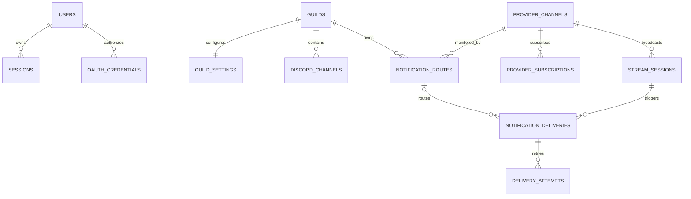

# Proposed relational schema

**YouTube formatting update — 2026-10-18:** reviewed `0006_youtube_embed_mentions.sql` adds default-false `notification_settings.mention_everyone`, preserving legacy opt-out, per-guild subscriptions, setting versions and delivery uniqueness. Migration passes isolated SQL tests; it was not applied to the currently unavailable local PostgreSQL server. [Current contract](YOUTUBE_NOTIFICATION_EMBEDS.md).

**Phase 7 actual schema:** additive `0005_phase07_reliability.sql` adds `monitor_sources.hint_version` and delivery attempt/version checks. Atomic candidate reconciliation protects concurrent webhook hints. Existing session/destination uniqueness, row-locked claims and attempt-matched completion remain the delivery authority. The reviewed migration chain was applied to development PostgreSQL; isolated real-PostgreSQL concurrency tests passed. See [Phase 7](PHASE_07_IMPLEMENTATION.md). Older phase-specific and future-entity descriptions below are historical/proposed, not claims that automatic delivery remains absent.

**Phase 6 actual tables:** `monitor_sources`, `monitor_sessions`, `monitor_receipts`, `monitor_limits` and `live_deliveries` persist baseline/schedules, hashed stream identity, webhook replay hints, budgets/cooldowns and delivery outcomes. Migrations `0003_phase06_monitoring.sql`/`0004_phase06_baseline.sql` reuse existing subscriptions/settings. `(session_id,guild_id,channel_id)` uniqueness and configuration/version checks prevent routine duplicate/cross-server delivery; interrupted sends remain uncertain. Payload cleanup/retention and deployment evidence are in [the Phase 6 implementation](PHASE_06_IMPLEMENTATION.md). The later entity catalog is a broader proposal, not a second implemented schema.

Phase 2 implements only Better Auth's native `auth_user`, `auth_session`, `auth_account` and `auth_verification` tables, with timestamp-with-time-zone columns, cascading auth-user foreign keys, provider/account uniqueness and lookup indexes. SQL is in `packages/database/migrations/0000_phase02_auth.sql` and was tested with the production Drizzle adapter in embedded PostgreSQL. Applying it to an external database remains an operator setup step. See [the auth contract](PHASE_02_AUTHENTICATION.md).

Phase 4 additionally implements the minimal global `provider_channels` identity registry and guild-scoped `streamer_subscriptions` in `0001_phase04_streamers.sql`. Unique provider/external ID and guild/source indexes prevent duplicates; source deletion cascades subscriptions. Original identifiers remain subscription-owned. The [Phase 4 contract](PHASE_04_STREAMER_REGISTRATION.md) specifies actual columns, cap/transaction behavior and metadata expiry/deletion. Phase 5 adds the settings/test tables described below; the broader proposed notification-route, guild defaults, automatic delivery and outbox tables remain unimplemented.

The entity catalog below remains the earlier **future domain proposal**, not a list of implemented tables. In the actual auth schema, Better Auth manages string internal IDs and signed opaque session identifiers (not the earlier custom hashed-session proposal). OAuth access/refresh tokens are encrypted using the library's account encryption. State uses the verification table plus a browser cookie. Discord IDs remain strings and permission arithmetic uses BigInt. The current minimal `provider_channels` does not contain the future monitoring/session fields listed below.

All tables have `created_at`; mutable tables have `updated_at`. `_id` references are foreign keys unless identified as external IDs. Secrets are encrypted with key-version metadata; encryption keys live outside the database.

## Entities

Phase 5 additionally implements `notification_settings` and `notification_test_attempts` in `0002_phase05_notifications.sql`. The settings composite guild/subscription FK reuses the Phase 4 identity/subscription model; a new unique `(guild_id,id)` subscription index supports it. Optimistic settings versions, a 30-second server test cooldown, seven-day request binding/deduplication and pending/sent/failed/uncertain outcomes are specified in [the Phase 5 contract](PHASE_05_NOTIFICATION_SETTINGS.md). Test history stores no message body or provider identity. This minimal test path is not the future general delivery/outbox schema below. Registration deletion/expiry cascades its settings; bounded test history is cleaned separately.

| Table | Main columns and purpose | Constraints |
| --- | --- | --- |
| `users` | `id`, `discord_user_id`, display name/avatar cache, `last_login_at`, `deleted_at` | Unique Discord user ID; cache expiry tracked |
| `oauth_credentials` | `id`, `user_id`, provider=discord, encrypted access/refresh token, scopes, `expires_at`, `key_version`, credential version | Unique `(user_id,provider)`; refresh updates serialized/versioned |
| `sessions` | `id`, `user_id`, hashed random session token, `expires_at`, `last_seen_at`, `revoked_at` | Unique token hash; no plaintext session token |
| `oauth_states` | `id`, hashed state, pending-session binding, purpose, intended guild optional, `expires_at`, `consumed_at` | Unique state hash, one-use consumption; no provider secrets |
| `guilds` | external Discord `id` as PK, name/icon cache, installation state (`unknown/installed/unavailable/removed`), `last_verified_at`, `removed_at` | Guild identity is not an authorization grant |
| `guild_settings` | `guild_id` PK, `paused`, default template/embed preference, `version`, `updated_by` nullable user ID | One per guild; defaults copied into new routes |
| `discord_channels` | Discord `id` PK, `guild_id`, type/name cache, bot-permission snapshot, `verified_at`, `deleted_at` | Unique `(guild_id,id)` supports tenant-safe composite FKs |
| `discord_roles` | Discord `id` PK, `guild_id`, name cache, mentionable, `verified_at`, `deleted_at` | Unique `(guild_id,id)`; never infer current permissions solely from cache |
| `provider_channels` | `id`, provider (`youtube/kick`), external channel/broadcaster ID, current handle/name/URL cache, uploads playlist optional, monitor/baseline state, `last_checked_at`, metadata expiry, `next_due_at`, error code | Unique `(provider,external_id)`; handles are mutable attributes |
| `notification_routes` | `id`, `guild_id`, `provider_channel_id`, `discord_channel_id`, `enabled`, `activated_at`, baseline state, template, embed flag, `mention_role_id` nullable, `version`, `created_by` nullable, `deleted_at` | Composite FK `(guild_id,discord_channel_id)` to channels and `(guild_id,mention_role_id)` to roles; partial unique active `(guild_id,provider_channel_id,discord_channel_id)` |
| `provider_subscriptions` | `id`, `provider_channel_id`, event type/version, external subscription ID, topic/callback opaque ID, encrypted hub secret optional, desired/actual state, `lease_expires_at`, `next_renewal_at`, `last_verified_at`, last error | Unique logical `(provider_channel_id,event_type,event_version)`; unique provider/external subscription ID when supplied |
| `stream_sessions` | `id`, `provider_channel_id`, `session_key`, external stream/video ID optional, state, title/URL cache, `scheduled_start_at`, `actual_start_at`, `actual_end_at`, `first_observed_at`, `last_observed_at`, `last_event_at`, metadata expiry | Unique `(provider_channel_id,session_key)`; YouTube key=video ID; Kick key=canonical UTC start instant under broadcaster |
| `event_inbox` | `id`, provider, subscription reference optional, provider message ID optional, `dedup_key`, received/event time, verified flag/mode, bounded payload, `status`, attempts, error, `processed_at`, `lease_until`, payload expiry | Unique `(provider,dedup_key)`; Kick message ID, YouTube normalized hint hash including payload update identity; no bare video-ID dedup for all future updates |
| `notification_deliveries` | `id`, `guild_id`, `route_id` nullable, `stream_session_id`, destination channel ID, type=`live_start`, status, suppression/error reason, deterministic nonce, rendered payload optional/expiry, `attempt_count`, `next_attempt_at`, `lease_until`, Discord message ID nullable, `sent_at` | Unique `(stream_session_id,guild_id,destination_channel_id,type)`; composite `(guild_id,route_id)` FK prevents tenant mismatch |
| `delivery_attempts` | `id`, `delivery_id`, attempt number, start/end, HTTP status, error category, Discord request/message ID if known, next delay | Unique `(delivery_id,attempt_number)`; redact response data |
| `outbox_jobs` | `id`, kind, logical key, aggregate ID, small JSON payload of IDs, `available_at`, `published_at`, attempts, `lease_until` | Unique logical key per operation; dispatch recoverable until processing acknowledged |
| `worker_requests` | `id`, `guild_id`, requesting user nullable, kind (`sync/test_send`), route nullable, idempotency key, status/result, authorization time, expiry | Unique `(guild_id,kind,idempotency_key)`; test sends separate from stream delivery uniqueness |
| `scheduled_tasks` | `id`, kind, subject ID, `next_due_at`, `lease_owner`, `lease_until`, attempts/error | Unique `(kind,subject_id)`; expiry allows crash recovery |
| `quota_usage` | provider, credential/project reference (not secret), bucket, window start/end, reserved/used counters, limit snapshot | Unique `(provider,credential_ref,bucket,window_start)`; atomic reservations; separate YouTube search and regular buckets |
| `audit_log` | `id`, `guild_id` nullable, actor user nullable, action, target type/ID, redacted change summary, request ID | Append-only; scoped guild indexes; no tokens or provider payloads |

`notification_routes` additionally needs unique `(guild_id,id)` for the delivery/request composite references. `worker_requests` uses the same composite route FK. A delivery's immutable destination identity is retained as a snapshot even if its route/channel cache is later removed. `stream_session_id` must correspond to the route's provider channel at creation, enforced transactionally; disallow changing a route's provider channel and create a replacement route instead.

## Relationships

## Transaction and indexing rules

- Claim due jobs/deliveries with row locks and leases (`FOR UPDATE SKIP LOCKED` or equivalent); do not hold a long database transaction open across provider HTTP calls. A per-route coordination lock must serialize send initiation with disable/delete; implement with a short-lived advisory coordination mechanism and bounded network timeout, tested explicitly.
- A session state transition, delivery insert and outbox insert commit together. Unique conflicts mean existing work, not another notification.
- Route deletion/recreation cannot bypass destination-level delivery uniqueness. Changing templates does not resend historical sessions. An explicit future resend feature would need a separate audited operation identity.
- Index routes by `(provider_channel_id,enabled)` and `(guild_id,deleted_at)`; deliveries by `(guild_id,created_at DESC)` and due status/time; inbox by unprocessed status/time; subscriptions/tasks by next due/lease expiry; sessions by channel/state and metadata expiry.
- Add check constraints for valid states, bounded counters, start/end ordering when known, supported provider/event values and nonempty stable IDs. Use optimistic configuration versions.
- Global provider tables are accessible only to internal services. Every dashboard query joins guild-owned records through an authorized guild ID; global data never exposes which other guilds follow a source. Consider PostgreSQL row-level security as defense in depth, with transaction-local tenant context and a non-owner DB role; it does not replace authorization. [PostgreSQL row security](https://www.postgresql.org/docs/current/ddl-rowsecurity.html).

## Proposed retention and deletion

Raw inbox bodies: 7 days; successful operational deliveries/attempts and audit entries: 30 days; OAuth state: minutes; sessions: proposed 7-day absolute/24-hour idle expiry. Encrypt tokens and purge on disconnect/account deletion. Keep deduplication keys only as long as needed within the bounded delivery/history period; never replay expired historical events. Active long-running session state must be refreshed and retained while monitored.

YouTube cached API data, including identifiers/URLs inside payloads and session records, needs refresh or deletion within 30 days. Track expiry per retained record, refresh active channels/sessions, and purge unused source/session records in dependency order. Do not hide stale API data inside audit JSON. Operational history should minimize provider metadata; retained hashes/tombstones and previously posted Discord messages require explicit policy review rather than an assumed exemption. Until resolved, expire NAVI-held historical YouTube data before the limit and assess deletion of bot-owned test messages as part of cleanup. [YouTube policies](https://developers.google.com/youtube/terms/developer-policies).

User deletion removes sessions/credentials and personal cache; anonymizes configuration authors/audit actors; guild configuration remains guild-owned unless the authorized manager deletes it. Guild removal pauses delivery immediately and proposes a 30-day recovery period before configuration purge. Global sources/subscriptions are retained only if another guild still requires them. Backups must expire on a documented schedule and restored data must reapply deletion records. Exact retention policy remains an approval item.
