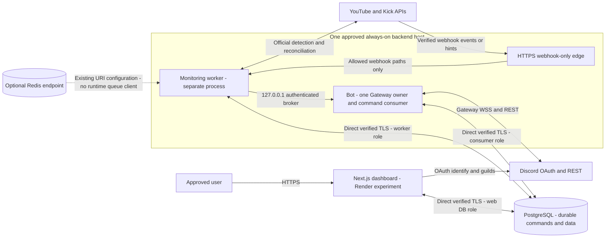

# Phase 15F — cloud deployment preparation and hosting feasibility

Date: **2026-10-25**, Asia/Colombo. **Preparation only. NO-GO for a complete continuously operating free/no-card cloud system, production activation, deployment or public release.** Configuration is ready for owner review subject to the gates below. No provider resource, production credential, DNS record, Portal setting, normal database migration, public installation setting or live notification was changed.

Reviewed Phase 15A/B architecture/design, Phase 15C/D/E implementation and evidence, the historical Render readiness report, actual code/configuration/migrations, Docker/Compose/edge files and current official provider documentation. Historical October 22 reports describe the earlier HTTP-only architecture; this plan supersedes their dashboard broker blocker, not their missing live-hosting evidence.

## 1. Architecture diagram

There is **no dashboard-to-bot HTTP connection in PostgreSQL mode**. Web admission binds the authenticated requester/session and freshly authorized guild; consumer execution rechecks scope/session, actual Discord authority and bot destination permissions. Settings plus acknowledgment remain atomic. Normal deliveries retain their own persistent uniqueness, leases, Retry-After handling and uncertain quarantine. No sender, platform, UI feature or queue architecture was replaced.

## 2. Hosting feasibility comparison

Facts below are provider documentation, not account eligibility or deployed observations. Estimates are explicitly labelled. No console/account provisioning was performed.

### Compute, availability and ingress

| Option                  | Card/payment requirement                                                                | Free resources and sleep/quota                                                                                      | Network, Gateway and background processes                                                                                                                                                              | Suitability                                                                               |
| ----------------------- | --------------------------------------------------------------------------------------- | ------------------------------------------------------------------------------------------------------------------- | ------------------------------------------------------------------------------------------------------------------------------------------------------------------------------------------------------ | ----------------------------------------------------------------------------------------- |
| Render Free web         | Tutorial documents no payment required; individual anti-abuse/card screening unverified | 0.1 CPU, 512 MB; 750 shared instance-hours/month; idle sleep after 15 min, roughly minute-long wake; ephemeral disk | Public HTTPS/WSS web ingress and outbound requests; no private inbound network, persistent disk or free worker service. Outbound Discord Gateway traffic is not proof it stays awake.                  | Experimental dashboard only. **NO** reliable continuous bot/worker or always-ready hooks. |
| Railway Free            | Advertised no card; full trial outbound access depends on automated verification        | $5/30-day trial then $1/month credit; up to 1 vCPU/0.5 GB per service afterward; 0.5 GB volume                      | Node/container workloads possible; limited-trial outbound restrictions can block required connectivity. Persistent runtime depends on resource credit and account settings; no NAVI soak/billing test. | Bounded eligible experiment, not demonstrated 24/7 free backend.                          |
| Koyeb Free              | Requires card verification; excluded from no-card recommendation                        | 0.1 vCPU, 512 MB, 2 GB ephemeral disk, one free instance; sleeps after 1 h                                          | Free instance is not a worker service and has no persistent volume/custom scaling; web ingress is not a background uptime guarantee.                                                                   | Does not meet card or continuity constraints.                                             |
| Cloudflare Workers Free | Free plan documented; actual account/card screening not verified                        | 100k requests/day, 10 ms CPU/invocation; not an always-running Node process                                         | Supports web/edge execution and WebSocket APIs, but current Next/discord.js/PG session-lock runtime is not a drop-in deployment. No port or migration implemented.                                     | Potential separately researched web/edge experiment; **not** the current bot/worker host. |
| alwaysdata              | Free/paid accounts exist; no-card enrollment not established here                       | Exact relevant free CPU/RAM quotas not verified; supervised Services explicitly paid-only                           | Headless supervised service support requires a paid plan; no complete NAVI mapping/capacity test.                                                                                                      | Not a verified free continuously supervised backend.                                      |
| Oracle Free             | Credit/debit-card verification explicitly required                                      | Capacity/region availability and reclaim policy not revalidated for this plan                                       | VM hosting is possible in principle, but signup already violates the no-card condition. No Oracle access or deployment performed.                                                                      | Excluded from no-card recommendation.                                                     |

Primary sources: [Render Free](https://render.com/docs/free), [Render CPU/RAM](https://render.com/docs/compute-plans), [Render first deployment](https://render.com/docs/your-first-deploy); [Railway pricing](https://railway.com/pricing), [trial restrictions](https://docs.railway.com/pricing/free-trial); [Koyeb pricing/verification](https://www.koyeb.com/docs/faqs/pricing), [instances](https://www.koyeb.com/docs/reference/instances); [Cloudflare pricing](https://developers.cloudflare.com/workers/platform/pricing/); [alwaysdata Services](https://help.alwaysdata.com/en/docs/web-hosting/services/); [Oracle signup verification](https://www.oracle.com/cloud/free/faq/). No trial credit is treated as an indefinite free allowance.

### Persistent data and endpoint components

| Component/provider     | Verified free facts                                                                                                                    | Connections, security and 24/7 assessment                                                                                                                                                                                                                                                                                          |
| ---------------------- | -------------------------------------------------------------------------------------------------------------------------------------- | ---------------------------------------------------------------------------------------------------------------------------------------------------------------------------------------------------------------------------------------------------------------------------------------------------------------------------------- |
| Neon Free PostgreSQL   | No card required; 100 CU-hours/project/month; 1 GB/project storage, 5 GB transfer; up to 2 CU/8 GB, scale-to-zero after 5 min          | Direct native PG/TLS is required by existing session advisory locks. Direct connection capacity depends on compute; verify actual max_connections/reserves. The advertised 10k pooled clients are not a direct-connection guarantee. Continuous 0.25-CU use exceeds Free compute.                                                  |
| Upstash Free Redis     | Pricing lists 250 MB, 10 GB transfer and 500K commands/month; free acquisition without card is documented, but no resource was created | Native TCP/TLS is documented; fixed CPU/RAM and actual account connection quota not verified. REST has blocking-command restrictions. Native TLS, reconnect, Pub/Sub and queue-library behavior remain untested against Upstash. NAVI has **no Redis queue/client**, so current command durability is unrelated to this allowance. |
| Render Free PostgreSQL | Temporary free DB expires after 30 days                                                                                                | Not suitable for retained authentication/deduplication/uncertain evidence. Not proposed as durable release storage.                                                                                                                                                                                                                |
| Public HTTPS hooks     | Need an approved, reachable origin routed to the existing worker with raw-body integrity and path restrictions                         | A sleeping web service is not equivalent to an always-ready webhook endpoint. Prepare an always-on host's ingress; actual DNS, certificates, signature acceptance, challenges and platform subscriptions remain blocked.                                                                                                           |

Sources: [Neon pricing](https://neon.com/pricing), [plans](https://neon.com/docs/introduction/plans), [pooling limitations](https://neon.com/docs/connect/connection-pooling), [secure connections](https://neon.com/docs/connect/connect-securely); [Upstash pricing](https://upstash.com/pricing/redis), [native protocol compatibility](https://upstash.com/docs/redis/overall/compatibility), [TLS](https://upstash.com/docs/redis/features/security), [REST restrictions](https://upstash.com/docs/redis/features/restapi); [Render DB lifetime](https://render.com/docs/free). Free CPU/RAM/connection limits not established by those sources are **unknown**, not unlimited.

Render's account-specific bandwidth/build allowances, Railway's actual account eligibility/credit exhaustion behavior, Cloudflare memory/bundle limits for a hypothetical port, and signup/network screening for untested accounts remain unverified. No listed web/edge free plan was proven to maintain NAVI's Discord Gateway and periodic background tasks continuously. Neon and Upstash are data services, not hosts for the bot/worker or an HTTP webhook receiver.

## 3. Recommended hosting configuration

**Retain local controlled beta at US$0 while hosting/approval gates remain open.** A sleeping web dashboard can be explored later, but does not make the whole system release-ready. No verified complete free, no-card continuous backend/database combination was found.

For a later funded deployment, the smallest practical architecture to evaluate is **one continuously running Linux VM**, initially about **2 GiB RAM / 1 vCPU**, hosting the website, bot, worker, private PostgreSQL and edge as separately supervised processes/containers. This reduces moving parts and removes Neon's continuously active compute charge. Keep PostgreSQL/broker private; retain the PG command mode and an available co-located HTTP rollback. Redis may use an approved Free Upstash endpoint if retained; the current production Compose file does not itself provision Redis and no Redis runtime queue should be invented.

Concrete price comparison, not a purchase recommendation: DigitalOcean's published Basic 2-GiB/1-vCPU/50-GiB/2,000-GiB-transfer VM is **US$12/month**. Backups, offsite storage, domain, taxes and eligibility/payment requirements are additional or unverified. A 1-GiB US$6 VM has less safety margin; it is not certified sufficient. Builds may need more memory than runtime and can run in a separately reviewed build environment. This alternative relaxes the US$0 condition and needs explicit budget/hosting approval. [Published VM prices](https://www.digitalocean.com/pricing/droplets).

If the split Render/Neon layout is retained instead, the diagram above is technically coherent, but both an always-on backend and sufficient database compute must be funded/verified. Neither option has been selected. Contingency US$15–25/month remains **not approved for spending**.

### Co-hosting bot and worker

Suitable **as separate supervised processes** on one host: independent restart/health, a single Gateway owner, same loopback namespace and existing worker broker secret/port. Do not combine their entrypoints, fake an HTTP keepalive or couple them to website traffic. Native service examples share host networking; worker startup ordering is not readiness, and the worker may survive temporary broker outages using existing persistence/retries. Docker containers must use the existing shared network-namespace arrangement; ordinary separate bridge containers do not share localhost.

Gateway ownership is host-local, not a distributed lease across deployments. Drain/stop the old owner before starting another host; do not horizontally scale whole bot processes merely because concurrent queue claims passed tests.

## 4. Resource and cost estimates for ten servers/ten unique sources

The code still caps approved beta scope at **five guilds**. Ten is resource planning only; no cap or onboarding restriction was changed. Shared source IDs mean ten unique monitors, not a separate external monitor for each server. Up to 100 logical subscriptions/destinations would still amplify Discord delivery work.

| Item                   | Estimate or measured basis                                                                                                                                                     | Free-tier implication                                                                                                                                                                              |
| ---------------------- | ------------------------------------------------------------------------------------------------------------------------------------------------------------------------------ | -------------------------------------------------------------------------------------------------------------------------------------------------------------------------------------------------- |
| Dashboard              | Rough planning 250–600 MiB runtime, request/GC spikes unknown; build may need 1.5–3 GiB                                                                                        | Render's 512 MB/0.1 CPU is not a measured fit. Owner-only/low-traffic beta may work; actual SSR/auth/cold-start load required.                                                                     |
| Bot + worker           | Prior offline Client floor ~78 MiB and worker descriptor ~37 MiB are **not monitoring memory**. Plan roughly 250–500 MiB backend aggregate with bursts, then measure           | 512 MB is not certified. No 24–72-hour full backend soak or production peak measured.                                                                                                              |
| All-in-one VM          | About 2 GiB/1 vCPU provisional, allowing OS/PG/edge/runtime headroom; not a capacity guarantee                                                                                 | Paid example above; local hardware can avoid a hosting bill but introduces owner availability/ingress limitations.                                                                                 |
| Queue idle polling     | Phase 15E measured 6 SQL statements/step, at 3 s ≈ **5.184 million statements/30 days**; same loop preserved                                                                   | Repeated activity prevents five-minute idle scale-to-zero. Not all statements are data reads; no claim of measured Neon CPU billing.                                                               |
| Neon compute           | 0.25 CU × 720 h = **180 CU-hours/30 days** vs 100 Free                                                                                                                         | At that rate allowance lasts ~400 h / 16.7 days. Published Launch rate implies ~**US$19.08 compute alone**, excluding other services/storage/transfer. Calculation, not an account bill.           |
| PG connection ceiling  | 5 query + 2 coordinator connections per process; web + consumer + worker up to **21**, plus probes/owner/rollout overlap                                                       | Pools are lazy; actual direct limit/reserved slots must be checked. Pooler incompatibility cannot be solved by its advertised client count.                                                        |
| YouTube reconciliation | With default budget 7200, internal 20% reserve and 4-call planning factor, 5 YouTube sources ~300 s, 10 ~600 s/channel                                                         | Ten-channel poll-only recovery reaches the existing 600-s freshness cutoff before extra delays. Missed webhook recovery/latency needs a controlled test; do not remove suppression to hide misses. |
| Kick reconciliation    | 5 sources × 1 snapshot/min ≈ 7,200/day, plus ~480/day identity discovery at 15-min cadence, subscription/auth/confirmation/retry traffic                                       | Estimate from current scheduler, not a confirmed platform allocation. Quota/rate limits and actual response sizes need measurement.                                                                |
| Queue storage          | Prior sample: command+attempt/index allocation 192 KiB for 50 compact completed reads; ~3.84 KiB/sample. Hypothetical 100 commands/day → ~11.25 MiB/month before excluded data | No automatic command pruning. Target metadata can be much larger; auth, snapshots, deliveries, WAL/bloat and tombstones add storage.                                                               |
| Redis                  | Current application command count from a Redis client is zero: no such client exists. Operational probes/future usage separate                                                 | 500K monthly Free allowance is not a budget for PostgreSQL statements. No queue migration to Redis proposed.                                                                                       |
| Dashboard polling      | At most 20 GETs/action, normally ≥3 s apart. Hypothetical 100 actions/day can add up to 2,000 polls/day plus fresh authorization                                               | Actual OAuth/DB latency and 429 frequency must be tested. No permission cache was loosened.                                                                                                        |

Neon prices/allowances are from [pricing](https://neon.com/pricing); request counts, connection ceilings and intervals are code-derived estimates. Metrics are local/synthetic, not ten-server production measurements.

**First failure:** continuous backend availability is not established on the qualifying free hosts. If a backend is otherwise supplied, **Neon compute is the first quantified monthly allowance exceeded**, before tiny fixture row storage. Render used for two continuously running instances would also consume 1,440 instance-hours/30 days versus 750 shared. Railway's hypothetical 0.25-GB average service at its published memory rate is ~US$2.50/30 days before CPU/network, exceeding $1 credit; actual usage is unknown. [Railway rates](https://railway.com/pricing). Existing ten-source YouTube freshness is a separate monitoring-capacity gate.

## 5. Environment variable checklist

| Service          | Required settings / protections                                                                                                                                                                                                                                                                                                                                                                                                      |
| ---------------- | ------------------------------------------------------------------------------------------------------------------------------------------------------------------------------------------------------------------------------------------------------------------------------------------------------------------------------------------------------------------------------------------------------------------------------------ |
| Web              | NODE_ENV=production, WEB_ORIGIN, restricted web DATABASE_URL, BETTER_AUTH_SECRET, DISCORD_CLIENT_ID/SECRET, DISCORD_ALLOWED_USER_IDS, BETA_GUILD_IDS, YOUTUBE_API_KEY, KICK_CLIENT_ID/SECRET, STREAMER_SOURCE_LIMIT ≤10. BOT_COMMAND_TRANSPORT remains HTTP by library default; explicitly choose postgres only after approval. BOT_COMMAND_ADMISSION_ENABLED=false during staging. No bot token or broker secret needed in PG mode. |
| Bot              | NODE_ENV, LOG_LEVEL, DISCORD_BOT_TOKEN, BOT_INTERNAL_SECRET (shared only with worker), BOT_STATUS_PORT. BOT_COMMANDS_ENABLED=false remains default. Prepared direct consumer DATABASE_URL and identical approved user/guild policy before any approved activation.                                                                                                                                                                   |
| Worker           | Restricted DATABASE_URL, existing REDIS_URL (native rediss for Upstash), provider credentials, BOT_INTERNAL_URL strictly loopback and matching secret, MONITOR_PUBLIC_ORIGIN/SECRET, MONITOR_PORT, YOUTUBE_DAILY_BUDGET, BETA_GUILD_IDS. MONITORING_ENABLED=false remains default.                                                                                                                                                   |
| Migration/backup | Separate owner credentials, never supplied to application builds/runtime or the dashboard. Private approved target and encryption/key/restore plan.                                                                                                                                                                                                                                                                                  |

Percent-encode URI credentials. Do not use TLS no-verify flags, query routing overrides or a Neon transaction-pooler endpoint. `sslmode=verify-full` is the prepared cloud profile; custom certificates/routing need explicit review rather than disabling verification. Keep auth/account encryption and webhook secrets stable during approved transfer/restarts. No production URL or credentials are invented in templates.

## 6. Deployment order (future approved actions only)

1. Approve host/payment method, budget, legal/support placeholders, exact user/guild scope, real origins, certificate/DNS approach and all external tests. No current step authorizes deployment.
2. Build/pin the reviewed image/runtime and test artifact in the approved environment. Apply a reviewed security edge profile; native Render does not automatically reproduce existing Nginx API throttling/host controls.
3. Back up source data, verify a separate restore and privately confirm the intended target. Provision restricted roles and verified network paths; keep DB/broker private or provider-protected TLS only.
4. Apply schema with owner once; apply reviewed grants and private readiness checks. No migration during build/startup.
5. Stage bot with consumer off and worker disabled. For a real Gateway login, obtain separate approval; verify only the approved installation/identity. Systemd examples are review-only and were not installed or started.
6. After approved consumer activation, stage web postgres mode with admission paused. Verify read-only/authenticated behavior and target identity. Configure exact callbacks only after origins are approved.
7. Enable admissions only after approval; run approved controlled onboarding/notification tests. Enable monitoring and webhook reconciliation only after destination isolation, mentions, historical-event handling and live-send approval are confirmed.
8. Soak, observe latency/quotas/duplicates and test restart/restore/alerts before any wider release. Keep private restrictions; no Public Bot or App Directory changes automatically.

Exact build/start commands are in [the updated Render README](../deployment/render/README.md). Render Blueprint import itself deploys and is not part of preparation.

## 7. Database migration and permission plan

Use migrations **0000–0007**, including `0007_phase15c_commands.sql`, only in a separately approved target. It has not been applied to the normal development database. Native source checkout migration: `npm run build:shared && npm run db:migrate`; Docker migration tooling is `/app`-specific. Neither is a build hook or automatic restart operation.

`deployment/command-permissions.sql` is review-only psql input with explicit web/consumer role variables and current approved target. It aborts for shared/administrative/invoking roles, resets command-table grants and grants the intended narrow rights. It creates no users/passwords, never runs at startup, and does not replace existing web/worker base grants. Review literal database/role names in the older base file before using it. Verify inherited privileges and ownership, not only GRANT statements.

- Web: existing auth/provider/subscription/settings/test access; command SELECT/INSERT and snapshot SELECT; requester boolean-function EXECUTE. No claims/acknowledgment/attempt/snapshot writes.
- Consumer: command SELECT/UPDATE; attempt/snapshot/settings SELECT/INSERT/UPDATE; test ledger SELECT/UPDATE; provider/subscription SELECT plus UPDATE(id) for row locks; boolean-function EXECUTE. No OAuth tables, DDL, owner, administrative role or command deletion rights.
- Worker: existing monitoring rights only. Schema owner: migration/backup tasks only.

Prepared grants and private role probes were actually exercised in the disposable integration DB, including rejection of database CREATE privilege and unauthorized auth-table access. The probe also rejects unexpected active schemas to reduce search-path shadowing risk. The bot now refuses opt-in command startup when its private dependency/privilege probe fails. No migration, role or credential change was made to normal services. Real distinct LOGIN credentials/cloud TLS remain unverified; tests use effective temporary NOLOGIN roles via local administrative login.

Keep all settings, monitoring/delivery records, attempts, receipts and dedupe evidence when moving data. Do not reset uncertain records or cascade-delete them to make a migration test pass. No new migration or retention policy was introduced.

## 8. Feature-flag activation plan

| Stage                          | Web transport     | Admission                                  | Bot consumer      | Monitoring                    |
| ------------------------------ | ----------------- | ------------------------------------------ | ----------------- | ----------------------------- |
| Current preparation            | HTTP default      | Inert under HTTP                           | false             | false                         |
| Approved maintenance staging   | Explicit postgres | false                                      | false initially   | false                         |
| Approved consumer verification | postgres          | false except controlled approved admission | true, one backend | false                         |
| Approved controlled test       | postgres          | true for approved scope                    | true              | Only separately approved true |

The Blueprint leaves transport to explicit operator input and pauses admission. Render prestart validation requires production auth settings, postgres mode and a valid PORT, and rejects a bot token in web process environment; it performs no external action. Merely having a DB URL does not enable consumption. Current user/guild policy must match across services; an accepted command is never silently sent through HTTP after a queue error.

## 9. Security and callback configuration

Preserve Better Auth secure production cookies, state/callback binding, current session checks, exact origins and backend guild authorization on every protected operation/status request. Discord callback is **`${WEB_ORIGIN}/api/auth/callback/discord`**, login scopes `identify guilds`; no invented DISCORD_REDIRECT_URI variable. Install links remain explicit and guild-authorized, using existing `bot applications.commands` scopes, Guild Install and minimum permissions. Keep private-beta restrictions/only Guilds Gateway intent; role/everyone permissions remain explicit and never automatic Administrator.

Kick callback is **`${MONITOR_PUBLIC_ORIGIN}/webhooks/kick`**; retain raw-body RSA/message/timestamp/event validation and the existing documented subscription flow. YouTube callbacks retain generated per-channel HMAC paths and challenge verification; feed events are hints, never proof of LIVE. The new webhook edge does not log URL/query/capability paths or forward dashboard/internal paths. Actual Portal configuration, signature acceptance and subscription renewal are blocked until approved endpoints exist. [Kick signature guidance](https://github.com/KickEngineering/KickDevDocs/blob/main/events/webhook-security.md), [YouTube push guidance](https://developers.google.com/youtube/data/guides/push_notifications).

Configure separate secrets per service, private owner access and TLS/firewall rules. Do not store secrets in Blueprint values, build args, logs or NEXT_PUBLIC variables. The scanner compares known credential values only in memory; an uncredentialed local Redis example is not a secret. Its result is bounded, not exhaustive secret detection or a compliance claim.

## 10. Monitoring, startup/shutdown and recovery

- Public `/api/health` is **liveness only**. Backend edge `/health` is private edge liveness, not consumer health. No artificial keepalive.
- Private `deployment/healthcheck.mjs` preserves existing bot/worker readiness; web PG mode and enabled consumer additionally check command schema, required/forbidden grants, nonadministrative role and identity-function access. Health time budgets/grace periods were adjusted for these dependencies. Role probe never claims, sends or mutates and explicitly reports `consumerHeartbeatVerified=false`.
- Dependency/Gateway health alone does not prove command processing. Before activation, require an approved read-only command canary, pending-age/expiry/uncertain counters and target-side progress monitoring/alert verification. No new public diagnostic endpoint or fake heartbeat was added.
- Co-hosted service examples forward SIGTERM and allow bot 75 s / worker 45 s shutdown windows; existing 60-s bot/30-s worker watchdogs and database close/recovery remain. Compose bot grace is now 75 s. Systemd installation/path/permissions and real Linux service-manager behavior still need target-host validation.
- Preserve bounded structured detection/delivery/error logs; broker routes remain private. Approve alert destination/credentials and a controlled alert test separately. No operational alerts were sent.
- Use approved encrypted offsite PG backups, separately secured key material and restore drills; provider snapshots alone are not demonstrated recovery. Existing operations/rollback runbooks still apply. Health and backup checks must not become mass-mention or notification tests.

## 11. Rollback procedure

1. Pause admission while retaining postgres mode and scoped status access. Do not dual-dispatch through the broker.
2. Drain only safe approved work, or stop the consumer and preserve leases/effect markers. Recover/expire unstarted commands; quarantine uncertain outcomes and inspect retained receipts. Do not blindly retry.
3. Keep schema/tombstones/history; do not drop migration 0007, reset terminal states or restore stale DB data over newer deliveries.
4. Revert HTTP only for a co-located website with the original private broker URL/secret. A Render dashboard cannot reach its own localhost broker; keep a maintenance/status path until relocating or resolving commands. Flipping HTTP is not reconciliation.
5. Verify actual DB target, role access, old single-owner process shutdown, sessions, queue state and private readiness before an approved restart. Keep backup before changes and require explicit approval for real sends/monitoring.

## 12. Verification results

Raw logs are ignored `.local/phase15f-*.log`; retained sanitized evidence is `docs/evidence/phase15f-results.json`. Discord/platform responses in automated scenarios are synthetic. Local physical PostgreSQL, Redis and Linux-container checks are identified separately.

| Check                               | Actual result / boundary                                                                                                                                                                                                                                                                                                            |
| ----------------------------------- | ----------------------------------------------------------------------------------------------------------------------------------------------------------------------------------------------------------------------------------------------------------------------------------------------------------------------------------- |
| Full automated checks               | **537 tests/43 files PASS**, TypeScript/lint/format PASS (`npm run check`). Final Vitest duration 9.32 s. Discord/provider/auth tests simulated; no real OAuth consent/send.                                                                                                                                                        |
| Focused configuration/startup tests | PASS; transport-specific requirements, canonical target identity, TLS/pooler rejection, disabled flags, grant/readiness failures and Render prestart checks without connections.                                                                                                                                                    |
| Native production builds            | PASS, shared packages/Next/bot/worker; no configured service startup.                                                                                                                                                                                                                                                               |
| Docker build                        | **PASS**, local Linux/amd64 `navi:phase15f-review`, Node 24.22.1. Image size ~1.22 GB on disk, not runtime RAM. Website-only liveness PASS in a no-network/no-host-port/credential-free disposable container; bot/worker not started. No cloud, readiness or ARM64 runtime claim.                                                   |
| PostgreSQL integration              | **27 scenarios PASS**, disposable DB only: reviewed grant body, private role readiness, original 26 auth/HTTP/claim/recovery/crash/uncertain cases. Prior legacy SQL scripts run inside that DB. No normal migration.                                                                                                               |
| Redis compatibility                 | **Five native local TCP probes PASS**. Actual Upstash TLS/REST/quotas/reconnect remain BLOCKED.                                                                                                                                                                                                                                     |
| Edge security                       | **14 original + 13 webhook-only checks PASS** in isolated no-network/no-host-port containers with synthetic TLS/upstreams; cleanup true. Future approved public hostname/certificate/binding unverified.                                                                                                                            |
| Compose and Blueprint               | Compose config validates without starting services; YAML parses/formats. Render API/account validation BLOCKED.                                                                                                                                                                                                                     |
| Dependency security                 | Full and production npm audit exit 0, zero findings. No dependency version change or OS-image certification.                                                                                                                                                                                                                        |
| Secret/configuration checks         | Scanner initially flagged a password-free local Redis example; confirmed false positive without printing values, corrected classification and added regression. **Final bounded scan PASS**: 21 preparation files and 19 client assets, eight in-memory known-credential candidates, zero matches. Not exhaustive secret detection. |
| Existing local release preflight    | **BLOCKED / expected not-ready**, exit 1: development mode, local nonpublic origins, plaintext local DB/Redis configuration and intentionally disabled monitoring. No real settings changed to make it pass.                                                                                                                        |
| Cloud/systemd/real integrations     | **BLOCKED / not executed**: no target/cloud provisioning, actual Portal/callback changes, real credentials/use, fresh LIVE sends, long soak, external alert or offsite restore verification.                                                                                                                                        |

An intermediate final rerun was blocked when Docker Desktop became unavailable: the isolated PG setup failed before scenarios and the build was interrupted. Docker was restarted under existing approval; only PostgreSQL and Redis auto-started, both healthy. Final isolated PG/Redis reruns and Linux build/liveness passed. Final metadata confirms no normal command table, zero leftover test databases/roles/schemas, and disabled web queue/bot consumer. No user data was deleted or uncertain delivery reconciled.

Reproduction commands: `npm run check`, `npm run build`, `npm run test:commands:integration`, `npm run test:redis:compatibility`, `npm run test:proxy`, `npm run test:proxy -- --backend`, `npm run cloud:check`, `npm run release:check` (expected local not-ready), `npm audit --json`, `npm audit --omit=dev --json`, `docker build --tag navi:phase15f-review .`, and `docker compose --env-file deployment/.env.deploy.example -f compose.production.yaml --profile tools config --quiet`. None authorizes starting configured services. The database integration command is isolated; do not substitute a normal database migration command.

Changed files: mode-aware release helpers/CLI; private DB readiness export and opt-in bot startup guard; deployment health/start/Compose adjustments; reviewed command-grant SQL and tested renderer; Render prestart/Blueprint/templates/README; backend unit/webhook-edge examples; bounded scanner; proxy fixture variant; focused tests and isolated harness; this plan/progress/evidence. No schema migration, production env, streamer configuration, sender or authentication behavior was changed.

Main files for review:

- `packages/database/src/command-readiness.ts`, `packages/database/src/index.ts`, `apps/bot/src/command-runtime.ts`.
- `scripts/check-release.ts`, `scripts/lib/release-configuration.ts`, `scripts/check-cloud-preparation.ts`, `scripts/lib/secret-candidates.ts`, `scripts/lib/command-grants.ts`, `scripts/validate-command-integration.ts`, `scripts/check-proxy.ts`, root `package.json`.
- `deployment/command-permissions.sql`, `deployment/healthcheck.mjs`, `deployment/start.mjs`, `compose.production.yaml`.
- `deployment/render/README.md`, `deployment/render/check-web.mjs`, `deployment/render/dashboard.yaml.example`, `deployment/render/web.env.example`, `deployment/render/bot.env.example`.
- `deployment/cloud/backend-webhooks.nginx.conf.example`, `deployment/cloud/navi-bot.service.example`, `deployment/cloud/navi-worker.service.example`.
- `tests/cloud-preparation.test.ts`, `tests/command-runtime.test.ts`, `tests/production.test.ts`, this plan, `docs/RENDER_DEPLOYMENT_READINESS.md`, `docs/PROGRESS.md`, `docs/evidence/phase15f-results.json`.

## 13. Remaining blockers and required approvals

| Blocker                                                            | Required evidence/approval                                                                                                                              |
| ------------------------------------------------------------------ | ------------------------------------------------------------------------------------------------------------------------------------------------------- |
| Complete free/no-card 24/7 hosting not viable under current design | Select/fund or explicitly provide an always-on host and sufficient database compute. No budget approval inferred.                                       |
| Actual cloud roles/TLS/direct locks and capacity                   | Approved isolated target; separate LOGIN credentials, direct verified TLS, actual limits/cold-start/restart/restore and load results.                   |
| Public origins/edge parity and callbacks                           | Approve exact domains, DNS, certificates, edge throttling and Portal changes; verify OAuth/challenges/signed hooks without logging capabilities.        |
| Fresh onboarding/LIVE notifications                                | Approve test accounts/guilds/destinations, scoped startup/reconciliation and each controlled send; retain timestamps/receipts/duplicate checks.         |
| Ten-server/ten-source capacity                                     | Separately review five-guild policy cap and quota/freshness/CPU/memory/connection limits; do not silently raise admission.                              |
| Queue progress, alerts, retention and disaster recovery            | Verify operational heartbeat/progress and external alerts; approve retention/erasure/uncertain reconciliation and encrypted offsite restore procedures. |
| Public service/policy/contact readiness                            | Confirm existing operator/legal/support/deletion placeholders before public use. No identities or contacts invented.                                    |

## 14. GO/NO-GO recommendation

**GO: Phase 15F preparation is reviewable.** The PostgreSQL dashboard transport has a coherent private-backend deployment plan, mode-aware preflight, tested role grants/readiness and rollback instructions.

**NO-GO: complete free/no-card continuous hosting, production queue activation, cloud deployment and public release.** Local/fixture success does not resolve the economic/availability constraints or blocked external integrations. The smallest practical funded alternative requires owner selection and spending approval, not automatic provisioning.

Stop after Phase 15F. No next phase, deployment, flag activation, Public Bot change, real notification or Git commit/push is authorized by this document.
